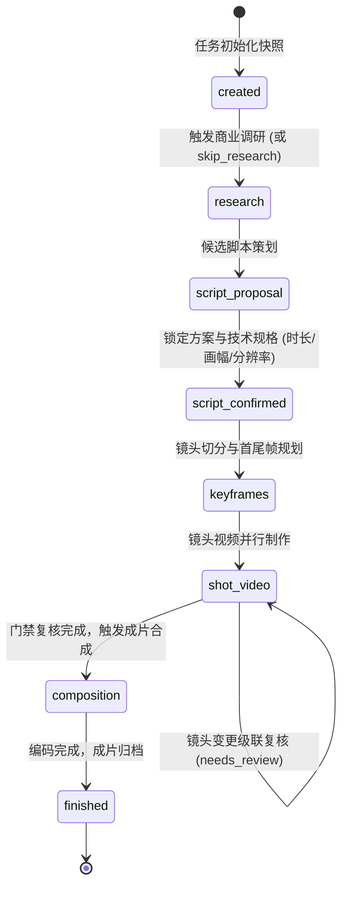

# FormaAI

> **FormaAI** 是面向短视频工业化生产的企业级 AI 协同制作平台。系统采用清晰架构（Clean Architecture）设计，基于严格确定的八阶段状态机推进短视频全生命周期研发，内置 302.AI 三模态独立主备高可用网关（覆盖语言模型、图像生成与视频生成），支持多模态看图策划脚本与单镜图生视频重做，底层提供多租户存储隔离及精准账单审计能力。

[](https://www.python.org/)
[](https://fastapi.tiangolo.com/)
[](https://vuejs.org/)
[](https://www.typescriptlang.org/)
[](https://tailwindcss.com/)
[](https://www.mysql.com/)
[](https://redis.io/)
[]()
[]()

---

## 目录

- [核心架构与技术特性](#核心架构与技术特性)
- [短视频 8 阶段流水线状态机](#短视频-8-阶段流水线状态机)
- [三模态独立主备高可用网关](#三模态独立主备高可用网关)
- [工程目录拓扑](#工程目录拓扑)
- [环境基线与前置要求](#环境基线与前置要求)
- [本地开发与部署启动](#本地开发与部署启动)
- [生产投产演练与准入预检](#生产投产演练与准入预检)
- [测试套件与代码质量门禁](#测试套件与代码质量门禁)
- [核心 API 端点规范](#核心-api-端点规范)
- [零信任安全与租户防护边界](#零信任安全与租户防护边界)

---

## 核心架构与技术特性

1. **工业级整洁架构（Clean Architecture）**
   - 严格分层隔离：基础设施层（Infrastructure）、领域模型（Domain Models）、应用服务（Router/Service）与交互契约（Schemas/DTO）。
   - 依赖反转与协议驱动：存储持久化、模型调度及用户会话均面向 Protocol 接口设计，测试桩与生产驱动可随时互换。

2. **三模态独立主备高可用网关（Tri-Modal HA Gateway）**
   - 对接 302.AI 多模型引擎，语言模型、生图模型与视频模型三模态相互解耦独立治理。
   - 每个模态独立配备 Primary $\to$ Fallback 自动熔断降级。
   - 指数退避重试（带随机抖动）抵御 429 与 5xx 瞬时抖动。
   - 自动记录真实耗时、Token 与 GPU 秒数及费用至 `UsageRecord` 审计账单。

3. **多模态视觉看图策划与单镜图生视频（Multimodal Vision & I2V）**
   - 策划阶段：支持将商品包装或实物参考图通过 Vision 消息体注入大模型，看图定制卖点与视觉分镜。
   - 制作阶段：单镜独立重做支持从品类素材库直选或输入外部图片作为参考图，以海螺或可灵图生视频（I2V）模式渲染。

4. **零信任与多租户隔离体系（Zero-Trust & Tenant Isolation）**
   - 双 Token 无状态认证（Access Token 短效 15m + Refresh Token 长效 7d）。
   - Redis 会话注销冷静期风控：账号注销进入冷静期后立即剥夺写权限，仅允许只读审计。
   - 存储路径防穿透：物理文件经 SHA-256 哈希散列与多租户路径边界校验，杜绝目录遍历漏洞。
   - 乐观锁版本控制（`version`）与全链路业务幂等防重放（`idempotency_key`）。

5. **极简企业级商务蓝 UI 体系**
   - 采用 Slate-900 / Slate-50 底色与 Blue-600 商务蓝单主色调，彻底摒弃多色块与臃肿文字堆砌。
   - 零 Mock 纯真实渲染，无缝支持品类预设直选、紧凑分镜编排与原画 MP4 下载。

---

## 短视频 8 阶段流水线状态机

系统使用强类型确定性有限状态机驱动视频制作流程，任何跨阶段跃迁均需提供幂等凭证与版本校验：



状态机流转规则：
- `created`：固化分类快照与业务初始输入（`theme`、`target_market`、`asset_ids`）。
- `research` $\to$ `script_proposal`：大模型自动生成三套风格各异的策划方案（A/B/C）。
- `script_confirmed`：锁定画幅（`9:16` 竖屏 / `16:9` 横屏）、分辨率（`1080p` / `4k`）与目标时长。
- `shot_video`：每个镜头拥有独立的 `VideoAttempt` 尝试记录，支持单镜图生视频重做与前序变动的级联复核通知。
- `composition` $\to$ `finished`：所有镜头通过复核验收后，执行物理拼接合成并固化最终成品制品。

---

## 三模态独立主备高可用网关

网关架构位于 `backend/src/formaai/infrastructure/model_gateway.py`，配置参数由 `formaai/config.py` 驱动：

| 模态类型 | 主选模型（Primary） | 备用模型（Fallback） | 接口协议 | 失败切换机制 |
| :--- | :--- | :--- | :--- | :--- |
| **文本大语言模型 (LLM)** | `deepseek-chat` | `gpt-4o` | 302.AI OpenAI 兼容接口 | 指数退避重试 2 次 $\to$ 熔断切换至 GPT-4o $\to$ 离线基线兜底 |
| **图片生成模型 (T2I/I2I)** | `doubao-seedream-5-0-260128` | `gpt-image-1.5-t2i` | 302ai CLI / REST 轮询 | 主模型超时/失败 $\to$ 自动调度备用生图模型 $\to$ 兜底快照 |
| **视频生成模型 (T2V/I2V)** | `minimax-hailuo-02` | `official-kling-v3` | 302ai CLI 异步轮询任务 | 海螺排队/拒单 $\to$ 切换快手可灵 V3 $\to$ 离线占位保护 |

- **多模态智能选网**：若任务关联了参考图片，脚本生成链路会自动识别模型的视觉能力，将提示词转换为 OpenAI Vision 规范并交由 `gpt-4o` 解析。
- **图生视频原生穿透**：单镜重做上传或勾选参考图后，网关使用 `--image` 参数唤醒海螺/可灵图生视频管线。

---

## 工程目录拓扑

```text
FormaAI/
├── docker-compose.yml              # 容器编排 (MySQL 8.4 + Redis 7.4)
├── docs/                           # 需求说明书与技术开发规范
│   ├── PRD.md                      # 产品需求说明书
│   ├── global-workflow.md          # 业务全流程图解
│   └── python-backend-development-handbook.md
├── backend/                        # Python 后端工程
│   ├── pyproject.toml              # UV 包依赖与工程配置
│   ├── alembic.ini                 # 数据库迁移配置
│   ├── migrations/                 # Alembic 数据库迁移版本 (7 个演进版本)
│   ├── scripts/                    # 运维与预检脚本
│   │   ├── reset_mock_data.py      # 清空测试数据
│   │   ├── seed_popular_categories.py # 初始化全量热门业务分类
│   │   └── verify_production_readiness.py # 生产准入 9 项自检脚本
│   ├── src/formaai/                # 后端核心源码
│   │   ├── config.py               # 强类型配置管理 (Pydantic Settings)
│   │   ├── infrastructure/         # 数据库连接池、私有存储、302.AI 高可用网关
│   │   └── modules/
│   │       ├── identity/           # 账号、双 Token 认证、会话与注销风控
│   │       ├── library/            # 业务分类、文本素材、视觉资产管理
│   │       └── production/         # 状态机、分镜规划、单镜重做、审计账单
│   └── tests/                      # 测试套件 (345+ 测试项，通过率 100%)
└── frontend/                       # Vue 3 前端工程
    ├── package.json
    ├── vite.config.ts
    ├── tailwind.config.js
    └── src/
        ├── api/                    # 统一 Axios 客户端与强类型接口定义
        ├── layouts/AppLayout.vue   # 企业级单顶栏极简布局
        ├── stores/auth.ts          # Pinia 认证持久化状态
        └── views/
            ├── DashboardView.vue   # 生产数据大盘
            ├── TasksView.vue       # 任务管理与多模态参考图创建弹窗
            ├── TaskStudioView.vue  # 8 阶段工作台、分镜列表与单镜重做
            └── LibraryView.vue     # 品类管理与媒体素材库
```

---

## 环境基线与前置要求

- **操作系统**：Linux / macOS / Windows 11
- **运行环境**：
  - Python: `>= 3.14`（推荐使用 `uv` 进行高效环境依赖管理）
  - Node.js: `>= 20.10.0`（包含 npm `>= 10.0`）
  - MySQL: `>= 8.0`（生产环境建议 MySQL 8.4 LTS）
  - Redis: `>= 7.0`
  - 302.AI CLI: `cli_302ai == 1.0.5`

---

## 本地开发与部署启动

### 1. 启动基础设施（Docker Compose）

```bash
docker-compose up -d
```
启动 MySQL（端口 3306）与 Redis（端口 6379）。

### 2. 配置环境变量

进入 `backend/` 目录复制环境模版：

```bash
cd backend
cp .env.example .env
```
根据实际环境核对连接配置：
```dotenv
FORMAAI_APP_ENV=development
FORMAAI_MYSQL_HOST=127.0.0.1
FORMAAI_MYSQL_PORT=3306
FORMAAI_MYSQL_USER=formaai_app
FORMAAI_MYSQL_PASSWORD=your_mysql_password
FORMAAI_MYSQL_DATABASE=formaai
FORMAAI_REDIS_URL=redis://127.0.0.1:6379/0

# 302.AI 网关配置
FORMAAI_AI302_API_KEY=sk-your-302ai-key
FORMAAI_AI302_LLM_PRIMARY_MODEL=deepseek-chat
FORMAAI_AI302_LLM_FALLBACK_MODEL=gpt-4o
FORMAAI_AI302_IMAGE_PRIMARY_MODEL=doubao-seedream-5-0-260128
FORMAAI_AI302_IMAGE_FALLBACK_MODEL=gpt-image-1.5-t2i
FORMAAI_AI302_VIDEO_PRIMARY_MODEL=minimax-hailuo-02
FORMAAI_AI302_VIDEO_FALLBACK_MODEL=official-kling-v3
```

### 3. 执行数据库迁移与热门分类预设

```bash
# 安装依赖
uv sync --locked --group dev

# 执行全量表结构迁移
uv run alembic upgrade head

# 预设主流电商、品牌、知识、剧情分类
uv run python scripts/seed_popular_categories.py
```

### 4. 启动后端服务

```bash
uv run python -m formaai --reload --port 8000
```
服务健康检查地址：`http://127.0.0.1:8000/health`。

### 5. 启动前端服务

进入 `frontend/` 目录：

```bash
cd frontend
npm install
npm run dev
```
浏览器访问前端：`http://localhost:5173`。

---

## 生产投产演练与准入预检

FormaAI 提供全自动生产准入自检工具，在发布投产前执行以下命令进行 9 项核心指标验证：

```bash
cd backend
uv run python scripts/verify_production_readiness.py
```

预检自检项覆盖：
- `[PASS]` 生产配置敏感度审计（调试热重载限制、生产级密匙长度）。
- `[PASS]` MySQL 连接存活与响应耗时（UTC 微秒时区兼容）。
- `[PASS]` Redis 缓存心跳与会话池连通性。
- `[PASS]` 本地/对象存储读写与边界防穿透权限。
- `[PASS]` 脏数据排查：确保生产数据库处于洁净零 Mock 状态。
- `[PASS]` 三级存活端点：`/health`、`/health/live`、`/health/ready` 状态 200。
- `[PASS]` 前端编译工件验证：`frontend/dist/index.html` 完整性与打包尺寸。

---

## 测试套件与代码质量门禁

后端工程采用严格的测试隔离与代码静态分析标准：

```bash
cd backend

# 代码静态风格与规范检查
uv run ruff check .
uv run ruff format --check .

# 强类型静态类型分析
uv run mypy src/formaai

# 全量测试套件执行 (345+ 项通过)
uv run pytest -v
```

前端工程编译与静态检查：

```bash
cd frontend
npm run build
```

---

## 核心 API 端点规范

| 模块 | 路由端点 | HTTP 方法 | 描述 |
| :--- | :--- | :--- | :--- |
| **认证管理** | `/api/auth/register` | `POST` | 新用户注册 |
| | `/api/auth/login` | `POST` | 登录颁发 Access/Refresh 双 Token |
| | `/api/auth/refresh` | `POST` | 凭 Refresh Token 轮换新凭证 |
| | `/api/auth/logout` | `POST` | 登出并立即吊销当前会话 |
| **素材分类** | `/api/categories` | `GET / POST` | 业务分类列表与创建 |
| | `/api/materials` | `GET / POST` | 结构化调研素材增删改查 |
| | `/api/assets` | `GET` | 媒体资产检索 |
| | `/api/assets/upload` | `POST` | 上传视觉图片/视频资产 |
| | `/api/assets/{id}/file`| `GET` | 资产物理文件安全读取 |
| **制作任务** | `/api/tasks` | `GET / POST` | 任务列表与创建初始快照 |
| | `/api/tasks/{id}` | `GET` | 任务详情与当前状态机阶段 |
| | `/api/tasks/{id}/decisions` | `POST` | 提交决策推进状态机阶段 |
| | `/api/tasks/{id}/shots` | `GET` | 分镜列表与制品版本详情 |
| | `/api/tasks/{id}/shots/{no}/redo` | `POST` | 单镜重做（支持传入参考图） |
| | `/api/tasks/{id}/compose` | `POST` | 触发成片合成门禁 |
| | `/api/tasks/{id}/download` | `GET` | 终版成片 MP4 流式安全下载 |
| | `/api/tasks/{id}/usages` | `GET` | 任务 Token/GPU 消耗审计账单 |

---

## 零信任安全与租户防护边界

1. **多租户数据防护**：
   - 所有的 Category、Material、Asset、Task 查询均强制注入 `user_id == current_user.id`。
   - 跨租户跨分类关联在外键前置校验中直接熔断拦截。
2. **防重放幂等凭证**：
   - 所有决策推进和模型生成任务必须携带 `idempotency_key`；相同凭证且参数一致时返回缓存快照，参数冲突时直接触发 `409 Conflict`。
3. **资产存储路径防穿透**：
   - `LocalStorageService` 对所有 `file_key` 执行绝对路径重整化，禁止 `..` 路径遍历与越权读取。

---

## 开源协议与版权

本项目采用商业专有协议授权（Proprietary License）。未经授权许可，禁止商业分发与二次转售。
Copyright © 2026 FormaAI Team. All rights reserved.
