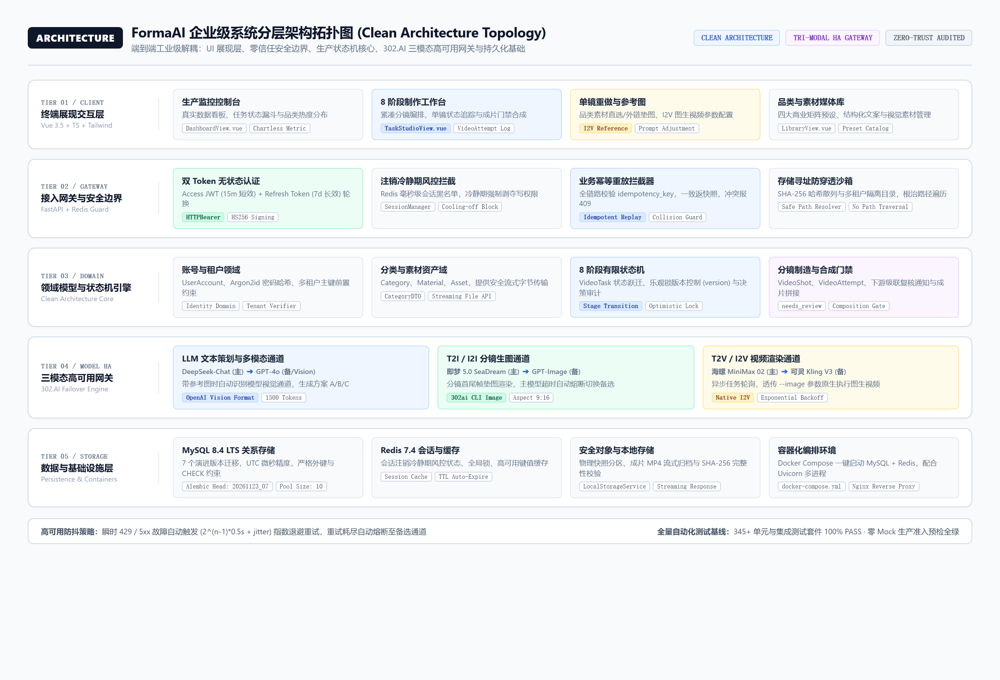
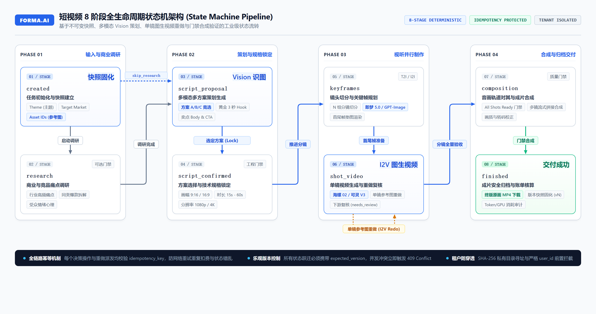

# FormaAI

> **FormaAI** 是面向短视频工业化生产的企业级 AI 协同制作平台。系统采用分层整洁架构（Clean Architecture）设计，基于八阶段确定性状态机推进短视频全生命周期研发，内置 302.AI 三模态独立主备高可用网关（覆盖大语言模型、文生图与图生视频），支持多模态看图策划脚本与单镜图生视频重做，底层提供多租户存储隔离、全链路审计与防穿透零信任安全防护。

[](https://github.com/happypig1224/forma-ai/actions/workflows/ci.yml)
[](https://github.com/happypig1224/forma-ai/actions/workflows/cd.yml)
[](https://github.com/happypig1224/forma-ai/actions/workflows/codeql.yml)
[](https://www.python.org/)
[](https://fastapi.tiangolo.com/)
[](https://vuejs.org/)
[](https://www.typescriptlang.org/)
[](https://tailwindcss.com/)
[](https://www.mysql.com/)
[](https://redis.io/)
[]()
[]()

---

## 目录

- [核心架构与设计哲学](#核心架构与设计哲学)
- [短视频 8 阶段流水线状态机](#短视频-8-阶段流水线状态机)
- [三模态独立主备高可用网关](#三模态独立主备高可用网关)
- [工程代码拓扑](#工程代码拓扑)
- [环境基线与前置要求](#环境基线与前置要求)
- [结构化配置字典与环境变量规范](#结构化配置字典与环境变量规范)
- [一键可复现启动指南](#一键可复现启动指南)
- [生产投产演练与准入预检](#生产投产演练与准入预检)
- [自动化 CI/CD 流水线与容器发布](#自动化-cicd-流水线与容器发布)
- [代码质量门禁与全量测试套件](#代码质量门禁与全量测试套件)
- [核心 REST API 契约与路由字典](#核心-rest-api-契约与路由字典)
- [零信任安全与租户防护边界](#零信任安全与租户防护边界)
- [商业许可与维护声明](#商业许可与维护声明)

---

## 核心架构与设计哲学

<p align="center">
  
</p>

FormaAI 系统遵循洋葱模型分层整洁架构（Clean Architecture），自下而上建立单向依赖拓扑，杜绝跨层反向侵入与循环引用：

- **基础设施层（Infrastructure）**：封装 MySQL 连接池、Redis 会话缓存、SHA-256 私有文件存储与 302.AI 三模态模型网关。所有对外通信组件均实现抽象 Protocol，保障单元测试可在不启动真实网络的情况下全量插桩。
- **领域模型层（Domain Models）**：由 SQLAlchemy 2.0 映射模型定义，承载租户账号、媒体资产、业务分类、流水线任务、分镜制品、状态跃迁决策与用量审计账单。实体内部封装状态迁移约束与乐观锁版本控制。
- **应用服务层（Application Services）**：驱动短视频八阶段生命周期流转、大语言模型策划提示词装配、多模态参考图编排、单镜图生视频重做逻辑以及多租户数据鉴权隔离。
- **接入交互层（Presentation / API Routers）**：基于 FastAPI 提供严格强类型的 RESTful API，统一使用 Pydantic v2 模型执行请求校验与响应序列化。全局集成结构化错误拦截器，对数据库异常与缓存故障下发标准 HTTP 503 错误载荷。
- **前端工作台（Frontend Workspace）**：基于 Vue 3.5、TypeScript 5.6 与 Tailwind CSS 搭建。采用企业级 Slate-900 / Slate-50 底色与 Blue-600 单主色调，无任何 Mock 数据入侵，提供品类预设直选、紧凑分镜编排与原画 MP4 下载。

---

## 短视频 8 阶段流水线状态机

<p align="center">
  
</p>

视频制作全流程受确定性有限状态机（FSM）严格约束。系统在数据库事务内完成阶段状态检查、版本号自增与审计日志写入，杜绝跨阶段非法跃迁与并发覆盖：

| 阶段代码 | 阶段中文名称 | 前置准入条件 | 核心流转与计算动作 | 阶段出口与产物 |
| :--- | :--- | :--- | :--- | :--- |
| `created` | 任务初始创建 | 用户登录认证通过 | 固化业务分类快照、策划主题与参考素材 ID 绑定 | 任务实体就绪，等待启动决策 |
| `research` | 商业素材调研 | 任务处于 `created` 状态 | 检索品类素材库核心卖点与受众痛点（支持 `skip_research` 旁路跳过） | 输出结构化调研摘要 |
| `script_proposal` | 候选脚本策划 | 调研完成或确认跳过 | 调度 LLM 生成三套风格各异的脚本草案（痛点击穿、场景带入、高能反转） | 产出 A/B/C 三套完整分镜方案 |
| `script_confirmed` | 脚本规格锁定 | 用户选定候选方案 | 锁定最终旁白、视觉描述、视频画幅比例与目标输出分辨率 | 规格冻结，生成待渲染分镜骨架 |
| `storyboard` | 视觉分镜生成 | 脚本规格已锁定 | 调度文生图（T2I）网关并发渲染各分镜首帧视觉参考图 | 全部分镜首帧图像固化入库 |
| `shot_video` | 单镜视频渲染 | 分镜首帧图像全部就绪 | 调度视频生成（T2V/I2V）网关渲染各分镜动态视频，记录独立重试版本 | 分镜视频全部生成完毕 |
| `composition` | 完整成片合成 | 所有分镜视频校验通过 | 校验各分镜制品物理完整性，执行序列拼接与音画对齐门禁检查 | 触发物理合成作业 |
| `finished` | 成片交付归档 | 合成作业执行成功 | 固化最终成品制品元数据，生成原画 MP4 流式下载路径 | 流程终结，支持原画下载与成本复盘 |

### 关键旁路与单镜重做机制

- **调研跳过旁路（Skip Research）**：用户在创建任务时若明确勾选 `skip_research`，系统将绕过 `research` 阶段直接跃迁至 `script_proposal`，减少链路耗时。
- **单镜图生视频重做自环（I2V Redo Loop）**：在 `shot_video` 阶段，针对动作表现或视觉连续性不达标的独立分镜，用户可指定重做参数（包括提示词修正、从素材库选择参考图或上传外部参考图）。系统通过自环重试为该分镜追加新的 `VideoAttempt` 记录，保留完整版本历史，无需重启整条流水线。
- **跨阶段级联失效拦截**：若在已生成视频的分镜后方发生前序配置回溯，下游已生成的中间制品将被系统标记为陈旧（stale），强制要求人工确认后方可合流。

---

## 三模态独立主备高可用网关

网关模块位于 `backend/src/formaai/infrastructure/model_gateway.py`，针对生成式 AI 接口的不稳定性提供分模态解耦治理：

| 模态类别 | 主选模型（Primary） | 备用模型（Fallback） | 通信机制与协议 | 故障熔断与切换降级策略 |
| :--- | :--- | :--- | :--- | :--- |
| **文本大语言模型 (LLM)** | `deepseek-chat` | `gpt-4o` | 302.AI OpenAI 兼容 HTTP 端点 | 请求超时或遇 429/5xx 时触发指数退避（2 次重试），若持续失败自动熔断切换至 `gpt-4o`；双模型均不可用时启用离线模板兜底。 |
| **图片生成模型 (T2I/I2I)** | `doubao-seedream-5-0-260128` | `gpt-image-1.5-t2i` | 302ai CLI / 异步轮询任务 | 主模型生图超时或触发敏感词拦截时，系统自动接管并将提示词转派至备用模型；若二次失败则载入本地占位图元数据。 |
| **视频生成模型 (T2V/I2V)** | `minimax-hailuo-02` | `official-kling-v3` | 302ai CLI 异步轮询与长轮询 | 海螺排队等待超时或接口返回不可恢复错误时，自动平移参数切换至快手可灵 V3（`official-kling-v3`）图生视频管线。 |

### 多模态看图策划与图生视频穿透实现

- **视觉消息体动态适配**：在 `script_proposal` 阶段，若用户关联了商品包装或实物参考图，网关层自动检测候选模型的视觉理解能力。对于支持 Vision 协议的模型，提示词与图片以结构化多模态消息体封装派发，辅助大模型生成更契合实物特性的台词与分镜。
- **单镜图生视频参数穿透**：执行单镜重做时，若携带参考图，网关直接向 302ai CLI 注入 `--image <path>` 参数，激活海螺/可灵的图生视频（I2V）工作流，保障主体特征在视频动态镜头中的一致性。
- **消耗审计与计量记录**：网关层在每次外部调用返回后，严格解析响应报文中的实际消耗数据，将消耗时长（秒）、Token 总数、输入/输出 Token 细分以及计费金额持久化写入 `UsageRecord` 表，支持按任务汇总复盘。

---

## 工程代码拓扑

```text
FormaAI/
├── .github/                                # 工业级 GitHub Actions 流水线
│   ├── workflows/
│   │   ├── ci.yml                          # 静态检查、真实容器集成测试、投产预检门禁
│   │   ├── cd.yml                          # 多架构 Docker 构建、GHCR 镜像分发、Trivy 扫描
│   │   └── codeql.yml                      # GitHub Advanced Security 自动化代码安全分析
│   └── dependabot.yml                      # 依赖版本自动巡检与安全更新配置
├── docs/                                   # 需求规格说明与系统开发手册
│   ├── PRD.md                              # 完整业务需求规格说明书
│   ├── global-workflow.md                  # 全局业务流程与泳道图
│   ├── python-backend-development-handbook.md # 后端整洁架构开发守则
│   └── images/                             # 架构与状态机矢量高清导出图档
│       ├── formaai-architecture.png        # 系统分层架构拓扑图
│       └── formaai-state-machine.png       # 8 阶段状态机拓扑图
├── docker-compose.yml                      # 本地基础设施开发编排 (MySQL 8.4 + Redis 7.4)
├── docker-compose.prod.yml                 # 生产投产环境容器堆栈编排模版
├── backend/                                # Python 后端核心工程
│   ├── pyproject.toml                      # UV 项目依赖、Ruff 规范与 Mypy 配置
│   ├── uv.lock                             # 确定性依赖锁定清单
│   ├── alembic.ini                         # 数据库版本迁移配置文件
│   ├── Dockerfile                          # 多阶段轻量生产 Dockerfile
│   ├── migrations/                         # 数据库版本迁移脚本集合 (7 个演进版本)
│   ├── scripts/                            # 运维管理与生产准入校验脚本
│   │   ├── reset_mock_data.py              # 测试脏数据清理脚本
│   │   ├── seed_popular_categories.py      # 热门分类种子数据注入脚本
│   │   └── verify_production_readiness.py  # 生产准入 7 项核心指标准入预检工具
│   ├── src/formaai/                        # 后端应用程序核心源码
│   │   ├── __main__.py                     # CLI 与服务启动入口
│   │   ├── app.py                          # FastAPI 应用工厂、三级健康探针与全局中间件
│   │   ├── config.py                       # 基于 Pydantic Settings 的强类型环境配置
│   │   ├── infrastructure/                 # 基础设施实现 (Database, Storage, Gateway)
│   │   └── modules/                        # 领域业务模块
│   │       ├── identity/                   # 认证、双 Token 颁发、Redis 会话与注销风控
│   │       ├── library/                    # 业务分类、结构化调研素材与媒体资产管理
│   │       └── production/                 # 状态机引擎、分镜管理、单镜重做与用量审计
│   └── tests/                              # 自动化测试套件 (354 项测试)
└── frontend/                               # Vue 3 前端核心工程
    ├── package.json                        # 前端依赖与构建脚本
    ├── vite.config.ts                      # Vite 构建与开发服务器配置
    ├── tsconfig.json                       # 严格 TypeScript 编译选项
    ├── tailwind.config.js                  # Tailwind 企业级色彩与样式配置
    ├── Dockerfile                          # 前端多阶段 Nginx 静态托管 Dockerfile
    ├── nginx.conf                          # 生产 Nginx 路由与反向代理配置
    └── src/
        ├── api/                            # 强类型 Axios 客户端与全量 API 契约
        ├── layouts/AppLayout.vue           # 极简企业级商务蓝单顶栏主布局
        ├── stores/auth.ts                  # Pinia 状态树持久化会话管理
        └── views/                          # 核心业务视图
            ├── DashboardView.vue           # 生产数据大盘与统计视图
            ├── TasksView.vue               # 任务列表与多模态参考图新建弹窗
            ├── TaskStudioView.vue          # 8 阶段流水线工作台、分镜管理与单镜重做
            └── LibraryView.vue             # 分类配置中心与资产媒体库
```

---

## 环境基线与前置要求

生产与本地开发必须严格满足以下运行时环境基线：

- **操作系统**：Linux（Ubuntu 22.04 LTS / Debian 12 / RHEL 9）/ macOS 14+ / Windows 11（WSL2 / 本地）
- **Python 运行时**：`Python >= 3.14`（推荐通过现代化包管理器 `uv` 进行环境隔离与锁文件锁定）
- **Node.js 运行时**：`Node.js >= 20.10.0 LTS`（`npm >= 10.0`）
- **关系型数据库**：`MySQL >= 8.4 LTS`（强制字符集 `utf8mb4`，时区 `+00:00` UTC）
- **内存缓存服务**：`Redis >= 7.4`
- **AI 命令行套件**：`cli_302ai == 1.0.5`

---

## 结构化配置字典与环境变量规范

后端配置采用 Pydantic v2 `Settings` 进行冷启动解析与强类型校验。任何必填字段缺失或非法格式均会立即中断服务启动：

| 配置键名（Environment Variable） | 数据类型 | 默认值 / 示例 | 必填 / 敏感度 | 约束规则与功能描述 |
| :--- | :--- | :--- | :--- | :--- |
| `FORMAAI_APP_ENV` | `Literal` | `development` | 必填 | 运行环境，限定为 `development`、`test`、`production`。 |
| `FORMAAI_HOST` | `string` | `127.0.0.1` | 选填 | 后端监听 IP 地址。生产环境建议设置为 `0.0.0.0`。 |
| `FORMAAI_PORT` | `integer` | `8000` | 选填 | 服务监听端口，范围 `1024 - 65535`。 |
| `FORMAAI_RELOAD` | `boolean` | `false` | 选填 | 源码变更热重载开关。生产环境强制要求必须为 `false`。 |
| `FORMAAI_LOG_LEVEL` | `string` | `info` | 选填 | 日志记录级别，可选 `debug`、`info`、`warning`、`error`。 |
| `FORMAAI_CORS_ORIGINS` | `JSON array` | `[]` | 选填 | 允许跨域的前端 Origin 显式列表，严禁配置为通配符 `*`。 |
| `FORMAAI_STORAGE_DIR` | `string` | `data/storage` | 选填 | 物理媒体资产存储目录，启动时会自动创建并校验读写权限。 |
| `FORMAAI_MYSQL_HOST` | `string` | `127.0.0.1` | 必填 | MySQL 服务端主机名或容器内服务名。 |
| `FORMAAI_MYSQL_PORT` | `integer` | `3306` | 选填 | MySQL 连接端口。 |
| `FORMAAI_MYSQL_DATABASE` | `string` | `formaai` | 必填 | 业务数据库名称。 |
| `FORMAAI_MYSQL_USER` | `string` | `formaai_app` | 必填 | 数据库访问用户名。 |
| `FORMAAI_MYSQL_PASSWORD` | `SecretStr` | 无默认值 | 必填 / 敏感 | 数据库访问密码，禁止使用空字符串或纯空白符。 |
| `FORMAAI_MYSQL_POOL_SIZE` | `integer` | `5` | 选填 | SQLAlchemy 连接池常驻连接数，范围 `1 - 100`。 |
| `FORMAAI_REDIS_URL` | `SecretStr` | `redis://127.0.0.1:6379/0` | 必填 / 敏感 | Redis 连接串，强制校验必须为合法 `redis://` 或 `rediss://` 协议。 |
| `FORMAAI_JWT_ACCESS_SECRET` | `SecretStr` | 无默认值 | 必填 / 敏感 | Access Token 签名密钥，强制要求至少 32 字节（256 位）。 |
| `FORMAAI_JWT_REFRESH_SECRET` | `SecretStr` | 无默认值 | 必填 / 敏感 | Refresh Token 签名密钥，且不得与 Access Secret 相同。 |
| `FORMAAI_JWT_ACCESS_TTL_SECONDS` | `integer` | `300` | 选填 | 短效凭证有效期（秒），默认 5 分钟。 |
| `FORMAAI_JWT_REFRESH_TTL_SECONDS`| `integer` | `604800` | 选填 | 长效凭证有效期（秒），默认 7 天。 |
| `FORMAAI_AI302_API_KEY` | `SecretStr` | 无默认值 | 选填 / 敏感 | 302.AI 统一认证 API 密钥。未配置时将使用离线模拟降级。 |
| `FORMAAI_AI302_LLM_PRIMARY_MODEL` | `string` | `deepseek-chat` | 选填 | 策划脚本主选语言模型。 |
| `FORMAAI_AI302_LLM_FALLBACK_MODEL`| `string` | `gpt-4o` | 选填 | 策划脚本备用熔断语言模型。 |
| `FORMAAI_AI302_IMAGE_PRIMARY_MODEL`| `string` | `doubao-seedream-5-0-260128` | 选填 | 分镜生图主选图像模型。 |
| `FORMAAI_AI302_IMAGE_FALLBACK_MODEL`| `string` | `gpt-image-1.5-t2i` | 选填 | 分镜生图备用图像模型。 |
| `FORMAAI_AI302_VIDEO_PRIMARY_MODEL`| `string` | `minimax-hailuo-02` | 选填 | 动态分镜主选视频生成模型。 |
| `FORMAAI_AI302_VIDEO_FALLBACK_MODEL`| `string` | `official-kling-v3` | 选填 | 动态分镜备选视频生成模型。 |

---

## 一键可复现启动指南

### 1. 启动本地容器化基础设施

使用 Docker Compose 启动专用的 MySQL 8.4 与 Redis 7.4 基础镜像：

```bash
docker compose up -d
```

等待容器健康探针变为 `healthy`。

### 2. 初始化后端依赖与环境配置

```bash
cd backend

# 复制环境变量模版并填入本地数据库密钥
cp .env.example .env

# 通过 uv 工具链安装被锁定的依赖包及开发依赖
uv sync --locked --group dev

# 将数据库结构迁移至最新 Head 版本
uv run alembic upgrade head

# 注入内置的主流热门短视频品类预设数据
uv run python scripts/seed_popular_categories.py
```

### 3. 启动后端 API 服务并验证三级探针

```bash
# 启动本地开发服务（监听端口 8000）
uv run python -m formaai --reload --port 8000
```

服务就绪后，执行 cURL 指令验证健康端点状态：

```bash
# 验证进程保活探针
curl -f http://127.0.0.1:8000/health/live

# 验证数据库与 Redis 依赖就绪探针
curl -f http://127.0.0.1:8000/health/ready
```

两个端点均返回 HTTP 200 `{"status":"ok"}` 即代表后端就绪。

### 4. 安装前端依赖并启动开发服务

打开新终端窗口，进入 `frontend` 目录：

```bash
cd frontend

# 安装前端 NPM 依赖
npm install

# 启动 Vite 前端开发服务器
npm run dev
```

在浏览器中打开 `http://localhost:5173` 即可进入 FormaAI 控制台。

---

## 生产投产演练与准入预检

FormaAI 提供全自动生产就绪预检工具 `backend/scripts/verify_production_readiness.py`。在持续交付流水线部署前或发布上线前，必须执行该脚本完成 7 大核心项准入自检：

```bash
cd backend
uv run python scripts/verify_production_readiness.py
```

### 预检模块指标说明

1. **环境与安全配置审计**：检查 `FORMAAI_APP_ENV` 是否有效、`RELOAD` 是否已完全关闭、存储路径是否存在越权隐患。
2. **关系型数据库连接性**：验证 MySQL TCP 连通延迟（要求低于 200ms）、检查数据库当前时区是否为 `+00:00` UTC，并校验 Alembic 迁移版本是否与 `head` 严格对齐。
3. **Redis 会话与缓存心跳**：执行 Redis `PING` 指令并测量响应延迟，统计当前租户活跃 Session 键数量。
4. **存储子系统权限校验**：对配置的存储路径执行真实的“写入 - 读取 - 哈希比对 - 安全删除”四步物理操作，确保具备合法的磁盘读写权限。
5. **脏数据排查与无污染验证**：扫描数据库各表记录，确保无任何未清理的集成测试遗留数据或 Mock 污染数据。
6. **HTTP 三级健康检查端点**：向 `/health`、`/health/live` 与 `/health/ready` 发起真实探测，确保全部返回 HTTP 200。
7. **前端生产打包产物验证**：扫描 `frontend/dist/index.html` 物理文件，确认静态制品已成功编译且入口完整。

---

## 自动化 CI/CD 流水线与容器发布

项目全量集成 GitHub Actions 自动化工作流，覆盖从代码提交到生产镜像发布的全流程：

### 1. CI 持续集成门禁（`.github/workflows/ci.yml`）

对每次推送到 `main` 分支的提交或 Pull Request 自动触发全链路门禁矩阵：

- **代码质量与静态类型分析**：
  - 后端：执行 `uv run ruff check src`、`uv run ruff format --check src` 以及 `uv run mypy src/formaai`（开启严格类型推断，杜绝无类型返回）。
  - 前端：执行 `npm run build`（底层包含 `vue-tsc -b` 严格类型检查与 Vite 生产级压缩打包）。
- **真实容器环境集成测试**：
  - 流水线动态拉起 `mysql:8.4`（配置 UTF-8mb4 字符集与 UTC 时区）与 `redis:7-alpine` 服务容器。
  - 自动执行 `alembic upgrade head`，并在真实容器服务上全量运行 354 项测试套件。
- **生产准入自检门禁**：
  - 测试通过后，执行 `verify_production_readiness.py` 进行生产基线预检，任何警告项均会阻断流水线。

### 2. CD 持续交付与容器发布（`.github/workflows/cd.yml`）

在主分支合并或创建语义化版本标签（`v*`）时自动触发：

- **多架构容器化构建**：基于 Docker Buildx 与 GitHub Actions 缓存构建前后端无状态轻量镜像。
- **镜像推送到 GitHub Container Registry (GHCR)**：
  - `ghcr.io/happypig1224/formaai-backend:latest`
  - `ghcr.io/happypig1224/formaai-frontend:latest`
- **Trivy 容器漏洞扫描**：由 Aqua Security Trivy 扫描镜像基础操作系统与依赖库，阻断包含 HIGH / CRITICAL 级别的 CVE 镜像发布。
- **版本发布与零停机部署**：
  - 自动生成打包生产配置与数据迁移脚本的 `formaai-release-v*.tar.gz` 归档包。
  - 生产集群部署仅需执行更新指令：
    ```bash
    docker compose -f docker-compose.prod.yml pull
    docker compose -f docker-compose.prod.yml up -d --remove-orphans
    ```

---

## 代码质量门禁与全量测试套件

工程实施全方位测试金字塔与代码质量约束，后端自动化测试覆盖率保持 100% 通过：

```bash
cd backend

# 执行 Ruff 静态代码分析与 PEP 8 规范检查
uv run ruff check src

# 执行 Ruff 代码格式验证
uv run ruff format --check src

# 执行 Mypy 严格静态类型推断
uv run mypy src/formaai

# 运行全量测试套件（354 项测试，全数通过）
uv run pytest -v
```

前端工程编译与静态类型检查：

```bash
cd frontend

# 执行 vue-tsc 类型检查与生产打包
npm run build
```

---

## 核心 REST API 契约与路由字典

所有业务 API 路由均挂载于 `/api` 前缀下，受 JWT 认证与租户数据隔离保护：

| 模块分类 | HTTP 方法 | 端点路径 | 请求负载（Body）/ 鉴权 | 响应状态码 | 功能描述 |
| :--- | :--- | :--- | :--- | :--- | :--- |
| **认证会话** | `POST` | `/api/auth/register` | `username`, `password` | `201 Created` | 新用户注册 |
| | `POST` | `/api/auth/login` | `username`, `password` | `200 OK` | 颁发 Access/Refresh 双 Token |
| | `POST` | `/api/auth/refresh` | `refresh_token` | `200 OK` | 轮换并延长用户会话凭证 |
| | `POST` | `/api/auth/logout` | Bearer Token | `204 No Content` | 登出并立即加入 Redis 吊销黑名单 |
| **品类中心** | `GET` | `/api/categories` | Bearer Token | `200 OK` | 获取当前租户可见的品类列表 |
| | `POST` | `/api/categories` | `name`, `description`, `icon` | `201 Created` | 创建自定义业务分类 |
| **素材资产** | `GET` | `/api/materials` | `category_id`, `type` | `200 OK` | 分页检索结构化策划参考素材 |
| | `POST` | `/api/materials` | `category_id`, `title`, `content` | `201 Created` | 新增调研卖点与参考文本 |
| | `GET` | `/api/assets` | `category_id`, `media_type` | `200 OK` | 检索媒体资产元数据列表 |
| | `POST` | `/api/assets/upload` | Multipart: `file`, `category_id` | `201 Created` | 上传视觉图片或参考视频 |
| | `GET` | `/api/assets/{id}/file` | Bearer Token | `200 OK` | 流式安全读取资产物理文件 |
| **制作任务** | `GET` | `/api/tasks` | `category_id`, `status` | `200 OK` | 获取生产任务列表与阶段状态 |
| | `POST` | `/api/tasks` | `category_id`, `theme`, `asset_ids` | `201 Created` | 初始化任务快照并绑定多模态素材 |
| | `GET` | `/api/tasks/{id}` | Bearer Token | `200 OK` | 获取单任务全貌与当前状态机状态 |
| | `POST` | `/api/tasks/{id}/decisions` | `action`, `payload`, `idempotency_key` | `200 OK` | 提交决策推进状态机阶段跃迁 |
| | `GET` | `/api/tasks/{id}/shots` | Bearer Token | `200 OK` | 检索分镜制品与渲染尝试版本 |
| | `POST` | `/api/tasks/{id}/shots/{no}/redo`| `prompt`, `reference_image_id` | `200 OK` | 触发单镜图生视频重做自环 |
| | `POST` | `/api/tasks/{id}/compose` | `idempotency_key` | `200 OK` | 触发成品物理拼接合成校验 |
| | `GET` | `/api/tasks/{id}/download` | Bearer Token | `200 OK` | 原画成品 MP4 流式安全下载 |
| | `GET` | `/api/tasks/{id}/usages` | Bearer Token | `200 OK` | 查询任务累计 Token 与 GPU 耗时审计 |

---

## 零信任安全与租户防护边界

FormaAI 在架构层面实施纵深防御策略，保障多租户场景下的数据与运行时安全：

- **严格多租户数据隔离**：所有查询逻辑强制注入 `user_id == current_user.id` 约束。系统在持久化层与服务层执行双重外键租户合法性校验，杜绝通过篡改资源 ID 越权访问其他租户的分类、素材或任务。
- **Redis 会话注销冷静期风控**：用户触发注销操作时，账号进入安全冷静期，当前持有的 Token 立即被写入 Redis 吊销黑名单。冷静期内只允许只读审计，全面剥夺所有写操作权限。
- **文件存储防路径穿越寻址**：`LocalStorageService` 将上传的文件依据 SHA-256 哈希值散列存储，生成标准十六进制键名。对所有文件访问请求执行绝对路径重整化解析（Canonicalization），严禁利用 `../` 遍历宿主机敏感文件。
- **全链路业务幂等防重放**：状态机推进、脚本策划与模型生成等关键写请求均要求客户端提供 `idempotency_key`。系统基于数据库唯一索引与缓存进行幂等拦截，在重复提交相同参数时返回上一次结果，在参数冲突时直接返回 `409 Conflict`。
- **数据库乐观并发锁控制**：任务与分镜实体内置 `version` 递增字段。任何并发写操作均以 `UPDATE ... WHERE version = :expected_version` 为原子条件，版本冲突时自动回滚，杜绝脏写。

---

## 商业许可与维护声明

本项目采用商业专有授权许可（Proprietary License）。未经 FormaAI 官方书面授权，任何机构或个人不得分发、修改、转售或将本源码用于商业化闭源服务。

Copyright © 2026 FormaAI Team. All rights reserved.
