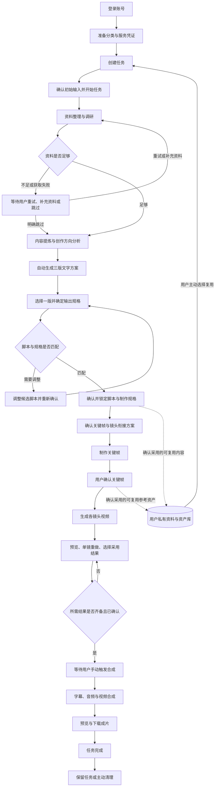

# 全局业务流程图

本图记录当前讨论的业务主流程，不代表数据库表结构或接口设计已经确定。

## 阅读说明

- 每个任务只选择一版文字方案继续制作；脚本与最终输出规格确认后一起锁定。
- 图中的入库箭头表示确认采用时保存可复用内容；具体页面是否合并确认操作，尚未最终确定。
- 关键帧参考方式需要匹配首版所选服务的实际能力。
- 单镜重做保留各次结果供选择；连续镜头的前镜结果变更后，后镜旧结果保留并标记需要复核。
- 暂停停止后续工作派发；已提交的外部请求继续跟踪。恢复先核对已有产物与远端状态，缺失结果需要用户确认后才能重新生成。
- 脚本、候选和生成媒体保存在任务私有临时空间，可跨重启恢复，保留到用户主动清理；不作为长期业务内容入库。
- 只允许清理已结束任务，包括成功和最终失败；已入库的可复用内容单独管理。
- 本图展示正常制作主线；账号注销、恢复与管理属于独立的账号及任务控制流程。
